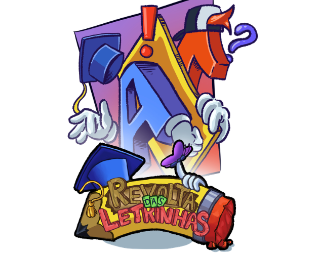
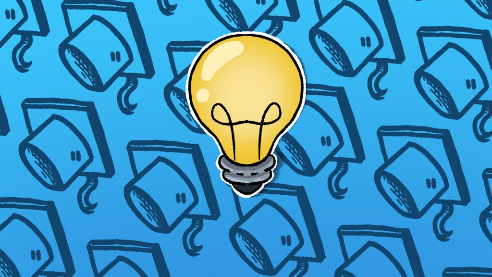

<div align="center">

  

  # 📚 A Revolta das Letrinhas
  ### *Uma aventura lúdica e educativa pelo fantástico universo da Língua Portuguesa!*

  <p align="center">
    <a href="https://unity.com/"></a>
    <a href="https://learn.microsoft.com/dotnet/csharp/"></a>
    
    
    <a href="https://itch.io/"></a>
  </p>

  <p align="center">
    <b>Desenvolvido com carinho por <a href="https://github.com/AnnaBezerraDev">Anna Luiza Bezerra</a></b>
  </p>

</div>

---

<div align="center">
  
</div>

## 📑 Sumário

- [Sobre o Projeto](#-sobre-o-projeto)
- [Principais Funcionalidades](#-principais-funcionalidades)
- [Mecânicas Educativas](#-mecânicas-educativas)
- [Galeria & Personagens](#-galeria--personagens)
- [Arquitetura & Tecnologias](#-arquitetura--tecnologias)
- [Como Jogar](#-como-jogar)
  - [Versão Web (Navegador)](#-versão-web-navegador)
  - [Versão Windows (.exe)](#-versão-windows-exe)
- [Como Rodar no Unity Editor](#-como-rodar-no-unity-editor)
- [Automação de Build](#-automação-de-build-para-o-itchio)
- [Licença e Autoria](#-licença-e-autoria)

---

## 🌟 Sobre o Projeto

**A Revolta das Letrinhas** é um jogo educativo em **2D** concebido para transformar o aprendizado de alfabetização, ortografia e gramática em uma experiência interativa, divertida e estimulante. 

O jogo desafia os pequenos jogadores a ajudarem o carismático protagonista **Zé** e seus amigos a resolverem confusões provocadas pelas letrinhas que resolveram fugir e trocar de lugar nas palavras!

### 🎯 Objetivos Pedagógicos:
- **Fixação Ortográfica**: Reconhecimento de grafemas com fonemas semelhantes (`S`/`SS`, `C`/`Ç`, `CH`/`X`, `Z`/`S`).
- **Compreensão Gramatical**: Introdução prática e intuitiva às classes de palavras (*Substantivo, Adjetivo, Verbo, Advérbio, Pronome e Conjunção*).
- **Raciocínio Lógico & Leitura Atenta**: Incentivo à observação do contexto das frases para dedução correta.

---

## ✨ Principais Funcionalidades

- 🧠 **Lógica Inteligente de Alternância**: Algoritmo dinâmico que impede a repetição imediata da mesma letra nas lacunas, garantindo variedade pedagógica a cada rodada.
- 📺 **Proporção Perfeita 16:9 (1920x1080)**: Gerenciamento inteligente de tela cheia com *letterbox/pillarbox* automático, garantindo nitidez sem distorção em qualquer monitor ou navegador.
- ⚡ **Tela de Carregamento Fluida**: Tela temática com animação de progresso suave pós-inicialização, integrando o jogador ao universo do jogo sem telas pretas ou congelamentos.
- 🎬 **Vídeos e Animações via Streaming**: Vídeos explicativos e cinemáticas gerenciados via `StreamingAssets` com fallback inteligente, permitindo carregamento leve e sem estouro de memória no WebGL.
- 🏆 **Sala de Troféus & Conquistas**: Registro de evolução e medalhas conquistadas ao longo da jornada.
- 👤 **Perfis de Jogador**: Criação e seleção de perfis individuais para acompanhar o progresso das crianças.

---

## 🎮 Mecânicas Educativas

| Mecânica | Descrição |
| :--- | :--- |
| **Completar a Palavra** | O jogador analisa a palavra no balão e seleciona a carta com a letra ou dígrafo correto (`SS`, `Ç`, `CH`, `X`, `Z`...). |
| **Desafio Gramatical** | Na etapa avançada, após completar a palavra, o jogador identifica a qual classe gramatical ela pertence. |
| **Sistema de Vidas** | Cada fase disponibiliza 3 corações. O feedback visual e sonoro imediato permite que a criança aprenda com os erros sem frustração. |
| **Vídeos Contextuais** | Antes de cada desafio maior, animações e vídeos apresentam a historinha e explicam o contexto. |

---

## 👥 Personagens

O universo do jogo conta com um elenco expressivo e ilustrado em detalhes:

- 🧒 **Zé**: O herói aventureiro sempre pronto para desvendar os mistérios das palavras.
- 👧 **Paty / Patty**: Companheira inteligente que adora gramática e livros.
- 👦 **Arthur**: O amigo curioso que sempre tem uma pergunta engenhosa.
- 👧 **Fernanda & Gabriela**: Dupla dinâmica que adora desafios de ortografia.
- 👵 **Vovó & 👩 Mamãe**: As guardiãs das histórias e das memórias da família.

---

## 🛠️ Arquitetura & Tecnologias

Este projeto foi construído utilizando as melhores práticas para jogos Unity em 2D:

- **Engine**: [Unity 6 (6000.3.0f1)](https://unity.com/)
- **Linguagem**: C# (.NET)
- **Render Pipeline**: Universal Render Pipeline (URP 2D)
- **UI & Tipografia**: TextMeshPro (TMP) com fontes customizadas estilo giz/lousa escolar (*Crayon Hand Regular*)
- **Animações de Interface**: [DOTween](http://dotween.demigiant.com/) para transições orgânicas de botões e cartões
- **Áudio**: SoundManager com trilha sonora adaptativa, efeitos de clique, acerto, erro e fanfarra de vitória
- **Suporte Multiplataforma**:
  - `Windows Standalone x64`
  - `WebGL (HTML5 / WebAssembly)` compatível com navegadores modernos (Chrome, Firefox, Edge, Safari)

---

## 🚀 Como Jogar

### 🌐 Versão Web (Navegador)
1. Acesse o jogo publicado na página do [Itch.io](https://itch.io).
2. O jogo roda diretamente no navegador, sem necessidade de downloads ou plugins adicionais.
3. Utilize o botão no canto inferior direito para ativar o modo **Tela Cheia** mantendo a fidelidade 1080p.

### 💻 Versão Windows (.exe)
1. Baixe o arquivo `Jogo_RevoltaDasLetrinhas_Windows.zip` na aba de [Releases](https://github.com/AnnaBezerraDev/A-Revolta-das-Letrinhas/releases).
2. Extraia o conteúdo para uma pasta no seu computador.
3. Dê um duplo clique em `RevoltaDasLetrinhas.exe`.
4. O jogo inicia automaticamente em resolução otimizada 1920x1080 com suporte ao teclado e mouse.

---

## 💻 Como Rodar no Unity Editor

Para abrir e desenvolver sobre o código-fonte:

### Pré-requisitos
- [Unity Hub](https://unity.com/download)
- **Unity 6000.3.0f1** instalado com os módulos:
  - *Windows Build Support (IL2CPP / Mono)*
  - *WebGL Build Support*

### Passo a Passo
1. Clone este repositório:
   ```bash
   git clone https://github.com/AnnaBezerraDev/A-Revolta-das-Letrinhas.git
   ```
2. Abra o **Unity Hub**, clique em **Add** e selecione a pasta do projeto.
3. Abra o projeto utilizando a versão `6000.3.0f1`.
4. No painel *Project*, navegue até:
   ```
   Assets / Lobby.unity
   ```
5. Abra a cena `Lobby` e pressione o botão **Play (▶️)** no topo do Editor.

---

## 📦 Automação de Build para o Itch.io

O projeto inclui um assistente automatizado de compilação em `Assets/Editor/ItchBuildHelper.cs`.

Pelo menu superior da Unity:
- `Publicacao > 1. Corrigir Proporcao da Tela e Videos (1920x1080)`: Normaliza automaticamente todos os Canvases e referências de vídeo.
- `Publicacao > 2. Gerar Jogo para Windows (.exe)`: Compila e gera o arquivo `.zip` pronto para distribuição.
- `Publicacao > 3. Gerar Jogo para WebGL`: Compila com o template responsivo e empacota o `.zip` com `index.html` na raiz para o Itch.io.
- `Publicacao > 4. Gerar Ambos (.exe e WebGL)`: Executa todo o pipeline em um único clique!

---

## 👩‍💻 Autora

<div align="center">
  <br />
  <h3><b>Anna Luiza Bezerra</b></h3>
  <p>Desenvolvedora de Software & Criadora de Jogos</p>

  <p>
    <a href="https://github.com/AnnaBezerraDev">
      
    </a>
  </p>
  <br />
</div>

---

<div align="center">
  <sub>Feito com 💖 para transformar a educação através dos games!</sub>
</div>
